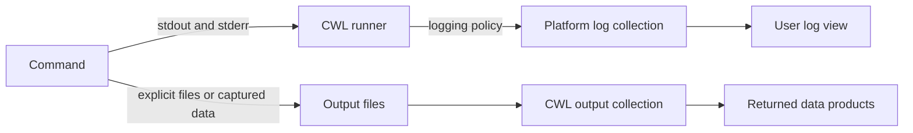

# Logging & Redirection in EOAP

Earth Observation Application Packages (EOAPs) describe processing tools and workflows that may run locally or on remote execution platforms. Clear logging helps developers diagnose failures and lets users follow long processing jobs.

This guide explains how to keep logs visible while producing usable data outputs with Common Workflow Language (CWL). The repository supplies three runnable tools under `examples/` and includes their source definitions in the guide.

## Start here

- [Getting started](getting-started.md): install a runner and execute your first tool.
- [Worked logging example](logging-example.md): compare explicit files, captured data, and captured diagnostics.
- [CWL patterns](cwl-patterns.md): inspect the tool definitions and output contracts.
- [Shell redirection](shell-redirection.md): understand pipelines, duplication, and exit status.
- [Troubleshooting](troubleshooting.md): investigate missing logs and incorrect outputs.

## How the pieces fit together

The runner can redirect a stream into an output file before it reaches platform collection. Local execution makes diagnostics available through the runner's terminal handling; remote display and retention depend on the deployment.

## Streams, files, and execution status

A process has two standard output streams:

| Channel | Typical purpose | Example |
| --- | --- | --- |
| `stdout` (file descriptor 1) | Normal output, including data when the CLI uses it that way | CSV rows or progress messages |
| `stderr` (file descriptor 2) | Diagnostics and operational messages | Warnings, progress, error details |
| Explicit output files | Durable data products collected by the workflow | GeoJSON, a raster, or `report.json` |
| Exit status | Whether the command succeeded | Zero for success; nonzero for failure by default |

The meaning of a stream comes from the CLI's contract. When `stdout` carries machine-readable data, send diagnostics to `stderr` so they do not corrupt that data. Writing an error message does not itself mark a job as failed: the command must also return an appropriate exit status.

## Keep logs available to the platform

Avoid redirecting diagnostic streams exclusively to files inside a tool. Omitting CWL's `stdout` and `stderr` fields leaves their handling to the runner. This lets an execution environment collect them according to its logging policy; it does not guarantee live streaming, retention, or access through an API.

Kubernetes normally collects container standard streams. A file written inside a container needs a separate collection mechanism to appear in those logs. A CWL runner can also redirect a subprocess before its messages reach the container streams, so verify the whole path from command to runner to platform. See the [Kubernetes logging architecture](https://kubernetes.io/docs/concepts/cluster-administration/logging/).

Calrissian and other workflow engines may associate messages with individual tasks. Platforms exposing OGC API Processes can choose how to expose execution logs; check the deployment's capabilities rather than assuming a particular log endpoint exists.

## Choose a pattern

| Tool behavior | Recommended approach |
| --- | --- |
| Emits only operational messages | Leave both streams available to the runner. |
| Writes results to named files | Declare those files in CWL `outputs`; keep diagnostics on standard streams. |
| Emits a data product on `stdout` | Capture `stdout` as a declared file and keep diagnostics on `stderr`. |
| Emits a formal diagnostic artifact on `stderr` | Capture it deliberately and provide another route for operational visibility. |
| Needs a persistent copy of logs | Consider platform log retention or an explicit duplication strategy; check failure behavior. |

Capturing a stream is appropriate when it is part of the tool's output contract. The mistake is treating every log stream as a data product without considering how users will see failures.

## What this guide includes

- [CWL patterns](cwl-patterns.md): complete tools for explicit files and captured data streams, plus an example of hidden logs.
- [Shell redirection](shell-redirection.md): redirection order, pipelines, `tee`, and exit status.
- [Troubleshooting](troubleshooting.md): investigate missing logs, malformed outputs, and failures that appear successful.

The examples use small shell commands to demonstrate stream handling. Real EOAP tools should also declare their runtime dependencies, resource requirements, and inputs as appropriate.

## Specification reference

CWL's command execution and output binding rules define how streams are captured and files are collected. See the [CWL v1.2 Command Line Tool specification](https://www.commonwl.org/v1.2/CommandLineTool.html) for the full execution model.
